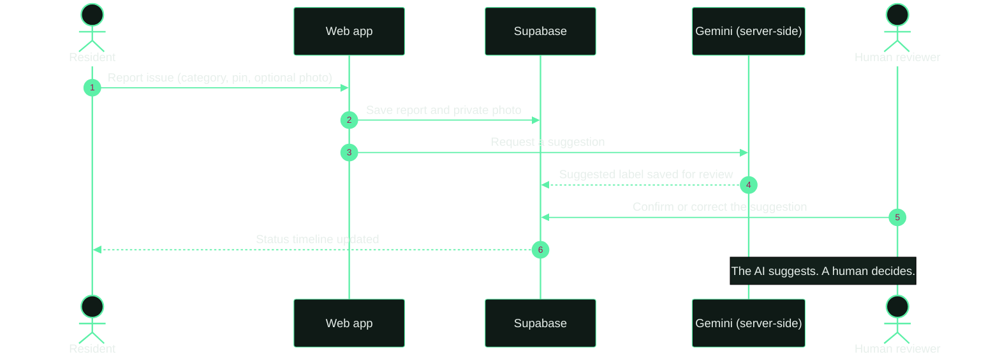
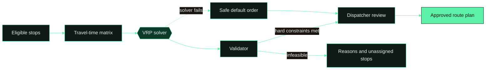
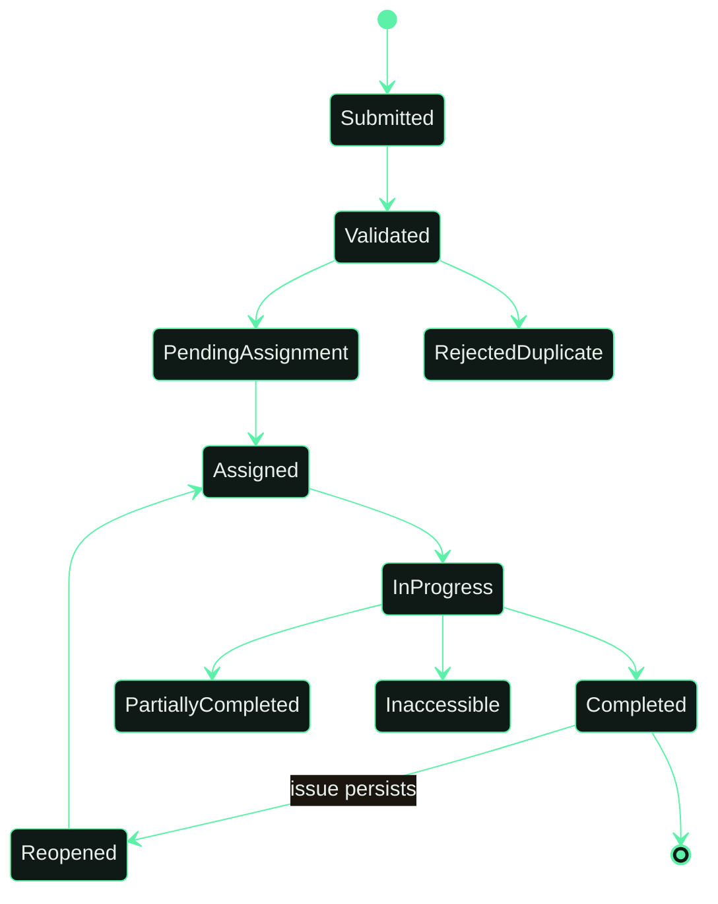

<div align="center">


<br/>

[](https://6cg9h4qr-5173.inc1.devtunnels.ms/)
[](#bengaluru-pilot)
[](#capabilities-and-status)


</div>


## Overview

EcoBrain AI is a waste-management platform that connects **residents**, **collection workers**, **dispatchers** and **administrators** in one workflow.

Waste collection is usually reactive: someone spots an overflowing bin, a complaint is raised, a vehicle is sent. EcoBrain AI moves towards a data-informed process that answers three questions:

> **What needs collecting, when, and in what order?**

AI results are always **suggestions, not proof**. A human reviews classifications and approves routes.


## Screenshots

<div align="center">

<br/><sub>Landing page, with demo content clearly marked <b>SIMULATED</b></sub>
</div>

<br/>

<table>
  <tr>
    <td width="50%"><br/><sub><b>Create account.</b> New signups are always residents; admins promote roles later.</sub></td>
    <td width="50%"><br/><sub><b>How it works</b> and the interactive route demo (Optimised / Original order).</sub></td>
  </tr>
  <tr>
    <td width="50%"><br/><sub><b>13 capabilities</b>, each labelled LIVE, PILOT SETUP or DEMO ONLY.</sub></td>
    <td width="50%"><br/><sub><b>Demo roles:</b> Resident, Worker, Dispatcher, Admin, Analyst.</sub></td>
  </tr>
</table>

<div align="center">

<br/><sub><b>Trust, privacy, human in the loop</b></sub>
</div>


## How it works




## Route optimisation

The same nine stops, visited in the original order and in an optimised order. The red stop is a high-priority case. Routes are recommendations and a **dispatcher approves** the final plan.


Try the real interactive version on the [live demo](https://6cg9h4qr-5173.inc1.devtunnels.ms/) using the **Optimised / Original order** toggle. The engine is a **TypeScript VRP** with baselines, a validator and human approval. Demo actions never write to the live database.




## Capabilities and status

Live account and resident-report integrations are kept separate from simulated operational demos. Demo-only features never create live records.

| Capability | What it does | Status |
|---|---|:---:|
| **Accounts and RBAC** | Live resident sign-up, sign-in and profiles. Staff role provisioning is not enabled. |  |
| **Reporting** | Resident reports, private photos and history stored in Supabase for the configured pilot area. |  |
| **AI image classification** | Gemini suggestions generated server-side and saved for human review. |  |
| **Priority and duplicates** | Transparent scores. Nearby matches are suggested, never silently dropped. |  |
| **Smart scheduling** | Shift planner ranking work by deadline, age and capacity. |  |
| **Route optimisation** | TypeScript VRP with baselines, validator and human approval. |  |
| **Worker interface** | Installable PWA, offline outbox, large touch targets. |  |
| **Supervisor dashboard** | Live queue, map, exceptions and assignment. |  |
| **Maps and hotspots** | Clusters, heat and recurring polygons, privacy-aware. |  |

<sub>Four more capabilities are listed on the <a href="https://6cg9h4qr-5173.inc1.devtunnels.ms/">live site</a>.</sub>

## Roles

| Role | Focus |
|---|---|
| **Resident** | Snap a photo, drop a pin, track the timeline |
| **Worker** | Task list for the shift, next stop, mark complete / inaccessible / follow-up |
| **Dispatcher** | Review the priority queue, assign work, approve route plans |
| **Admin** | Users and roles, service areas, vehicles, settings |
| **Analyst** | Hotspot maps, service trends, route metrics |

New signups are always residents. Admins promote roles later.


## Where the AI is, and where it is not

Not every automated rule is called AI here.

```mermaid
%%{init: {'theme':'base','themeVariables':{'primaryColor':'#0f1a16','primaryTextColor':'#e7efeb','primaryBorderColor':'#5df0a8','lineColor':'#5df0a8','clusterBkg':'#0b1210','clusterBorder':'#1b2a25'}}}%%
flowchart LR
    subgraph RULES[Deterministic rules]
      R1[Validation]
      R2[Status transitions]
      R3[Permissions]
      R4[Transparent priority scores]
    end
    subgraph ML[AI-assisted interpretation]
      M1[Gemini image suggestion]
      M2[Confidence and review]
    end
    subgraph OPT[Optimisation]
      O1[Vehicle routing]
      O2[Capacity, shifts, priority]
    end
    RULES --> ML --> OPT --> HUMAN([Human approval])
    style HUMAN fill:#5df0a8,stroke:#07150f,color:#07150f
```



| Layer | Technique | Guardrail |
|---|---|---|
| Workflow | Deterministic rules | Server-enforced permissions |
| Image classification | Gemini, server-side | Suggestion only, saved for human review |
| Route planning | VRP optimiser | Validator, human approval, safe fallback order |

## Report lifecycle



## Architecture


## Analytics

Dashboards turn operational records into a clear current-state view: open and overdue requests, time to resolution, and recurring hotspots. Every metric needs a precise definition, and simulated figures are always labelled.


## Trust, privacy and human in the loop

- Account sessions and resident-report access are **enforced by the server**.
- AI results remain **suggestions, not proof**. Low-confidence cases go to a person.
- Operational modules stay demo-labelled until they use live records.
- Photos are private and access-controlled. Exact locations are not shown publicly.
- Simulated data is always labelled **SIMULATED**.

## Bengaluru pilot

| | |
|---|---|
| **Selected pilot** | Ramaswamy Palya Ward 1, Bengaluru |
| **Status** | Setup in progress |
| **Live today** | Resident sign-up, sign-in and profiles |
| **Pilot setup** | Reports, private photos, AI suggestions saved for review |

## Roadmap

| Phase | Scope |
|---|---|
| 1. Foundation | Authentication, roles, app shell, database schema |
| 2. Reporting | Create, list and track reports, photo upload |
| 3. Dispatch and worker flow | Assignment, task list, completion and exceptions |
| 4. Maps and route baseline | Map view, travel estimates, route proposal, approval |
| 5. AI classification | Model integration, confidence handling, evaluation |
| 6. Analytics | KPIs, hotspots, exports |
| 7. Hardening | Security checks, tests, deployment, documentation |
| 8. Extensions | Forecasting, IoT sensors, offline sync, multi-vehicle planning |

## Evaluation approach

- **Classification:** per-class precision, recall and F1, confusion matrix, and the share sent to human review.
- **Routing:** compare the optimised plan with the original order and a nearest-neighbour baseline on the same inputs: distance and time, constraint violations, runtime, unassigned stops.
- **Operations:** median and 90th-percentile resolution time, on-time completion, repeat reports.
- Results from synthetic data are labelled as simulation, never as real-world outcomes.


## Getting started

```bash
git clone https://github.com/chethankp365/EcoBrain-AI.git
cd EcoBrain-AI
npm install
cp .env.example .env   # add Supabase keys; keep the Gemini key server-side only
npm run dev
```

Or try the hosted demo: **[EcoBrain AI live demo](https://6cg9h4qr-5173.inc1.devtunnels.ms/)**

## Repository layout

```text
├── src/            web app source
├── api/            server-side functions
├── shared/         shared types and logic
├── supabase/       database migrations
├── tests/          automated tests
├── docs/           documentation
├── public/         static files
└── README.md
```

<div align="center">

<br/>

[](https://6cg9h4qr-5173.inc1.devtunnels.ms/)

<sub>© 2026 EcoBrain AI · Bengaluru resident pilot</sub>

</div>
